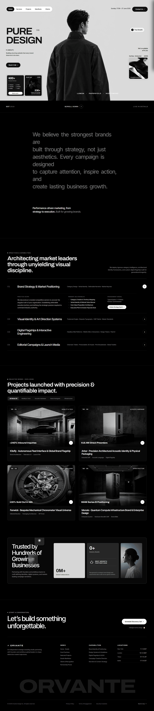

# ◼ Creative Agency & Portfolio
### Pure Design. Bold Ideas. Digital Experiences.

A premium, minimalist creative agency website crafted to showcase
brands, ideas, and digital experiences through thoughtful design and
impactful storytelling.


**[Live Demo](https://company.teamcodding.com)** · **[Preview](https://company.teamcodding.com)**
:::

------------------------------------------------------------------------

## ✦ Overview

**ORVANTE** is a premium creative agency and portfolio website concept
built around a simple idea: great design should do more than look
beautiful --- it should create impact.

The experience combines bold typography, monochrome visuals, spacious
layouts, refined interactions, and carefully structured content to
present a studio's identity, services, projects, and achievements.

Designed for creative studios, digital agencies, branding experts, and
independent designers who want a distinctive online presence.

## ◈ Design Preview

> Add your project screenshots to the `screenshots/` folder and update
> the image paths below.

### Homepage --- Hero Experience



*An editorial-inspired hero layout with bold typography, monochrome
imagery, and a clean navigation system.*
:::

## ✦ Visual Direction

The visual identity follows a restrained, high-contrast design language.

-   ** Colour palette:** Monochrome black, white, and soft grey.
-   **Typography:** Oversized, bold, modern sans-serif headlines.
-   **Layout:** Spacious, editorial-inspired composition.
-   **Imagery:** High-contrast photography and architectural visuals.
-   **UI style:** Rounded navigation, subtle borders, clean cards, and
    minimal controls.
-   **Experience:** Content-first storytelling with a premium studio
    aesthetic.

## ✧ Website Sections

1.  **Hero / Home** --- Brand introduction, featured visual, and primary
    CTA.
2.  **About / Manifesto** --- The philosophy and approach behind the
    studio.
3.  **Services** --- Brand strategy, visual identity, digital
    experiences, and campaigns.
4.  **Selected Projects** --- A curated portfolio of creative work.
5.  **Studio Highlights** --- Key numbers and credibility indicators.
6.  **Contact** --- A direct invitation to start a project.
7.  **Footer** --- Essential links and studio information.

## ✦ Tech Stack

Update this section to match the technologies actually used in your
project.

-   **Frontend:** React
-   **Styling:** Tailwind styling approach
-   **Animations:** Javascript
-   **Build Tool:** VS Code
-   **Deployment:** Vercel / Netlify / GitHub

## 📁 Laravel + React Project Structure

ORVANTE is organised as a Laravel application with a React frontend. The following structure is a recommended setup using **Inertia.js** to connect Laravel and React.

```text
ORVANTE/
│
├── app/
│   ├── Http/
│   │   ├── Controllers/
│   │   ├── Middleware/
│   │   └── Requests/
│   ├── Models/
│   ├── Providers/
│   └── Services/
│
├── bootstrap/
├── config/
│
├── database/
│   ├── factories/
│   ├── migrations/
│   └── seeders/
│
├── public/
│   ├── images/
│   ├── assets/
│   ├── build/
│   └── favicon.ico
│
├── resources/
│   ├── js/
│   │   ├── Components/
│   │   ├── Layouts/
│   │   ├── Pages/
│   │   ├── Sections/
│   │   ├── Hooks/
│   │   ├── Utils/
│   │   └── app.jsx
│   ├── css/
│   │   └── app.css
│   └── views/
│       └── app.blade.php
│
├── routes/
│   ├── web.php
│   ├── api.php
│   └── console.php
│
├── storage/
├── tests/
│   ├── Feature/
│   └── Unit/
│
├── screenshots/
│   ├── homepage.png
│   ├── services.png
│   ├── projects.png
│   └── contact.png
│
├── .env.example
├── artisan
├── composer.json
├── package.json
├── vite.config.js
├── phpunit.xml
├── README.md
└── LICENSE
```

### Frontend & Backend Directory Guide

| **Frontend — React** | **Backend — Laravel** |
|---|---|
| `resources/js/Components/` — Reusable UI components | `app/Http/Controllers/` — Handle incoming requests |
| `resources/js/Layouts/` — Shared page layouts | `app/Http/Requests/` — Validate incoming form data |
| `resources/js/Pages/` — Main website pages | `app/Models/` — Eloquent database models |
| `resources/js/Sections/` — Hero, About, Services, Projects | `app/Services/` — Application and business logic |
| `resources/js/Hooks/` — Custom React hooks | `database/migrations/` — Database table definitions |
| `resources/js/Utils/` — Helper functions and utilities | `database/seeders/` — Seed initial or sample data |
| — | `routes/` — Web, API, and console route definitions |

*This is a recommended Laravel + React + Inertia.js layout. Your actual project may contain additional Laravel files and directories depending on the installed packages and implementation.*

## 📄 License

Choose and add the license that matches how you want this project to be
used. For example, you can use the MIT License by adding a `LICENSE`
file.

------------------------------------------------------------------------
